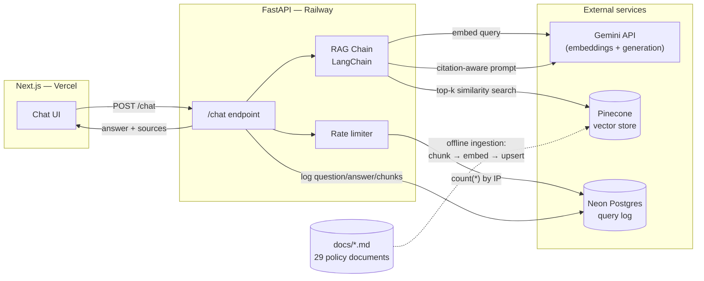

# Baobab Freight Assistant

A citation-grounded RAG chatbot that answers questions over a fictional South African freight & logistics
company's internal policy and compliance documents — customs, delivery SLAs, dangerous goods, claims, cross-border
documentation, and more. Every answer cites the specific document and section it came from, and the assistant
explicitly says when it doesn't know something rather than guessing.

**Live demo:** https://baobab-freight.vercel.app/

> **⚠️ Baobab Freight & Logistics is entirely fictional.** The company, its policies, routes, and every document
> in [`docs/`](./docs) were invented for this project to demonstrate RAG engineering. None of it describes a real
> business, and nothing in it is real freight, customs, or legal advice.

---

## Why this exists

This is a portfolio project built to demonstrate practical RAG engineering — not a toy demo. The interesting parts
are the retrieval quality, the citation grounding, and the explicit refusal to hallucinate when the answer isn't
in the documents. The chat UI is deliberately simple so those parts stay the focus.

## Architecture



**Request flow:** the frontend calls `POST /chat` with just `{question}` — the backend derives the caller's IP
itself server-side (`X-Forwarded-For`, since a client-supplied IP would make rate limiting trivially bypassable).
It checks the IP's usage count against Neon, embeds the question with Gemini (`task_type=RETRIEVAL_QUERY`),
searches Pinecone for the top-5 most similar document chunks, and — only if the top result clears a similarity
threshold — builds a citation-aware prompt and calls Gemini to generate an answer grounded strictly in those
chunks. The question, answer, retrieved chunk IDs, IP, and latency are logged to Neon regardless of outcome
(including failures), and the answer with its source citations is returned to the frontend.

**Ingestion is offline**, not part of the live request path: a standalone script chunks every document in `docs/`
along its own section boundaries (never a fixed character count — see [`backend/scripts/ingest.py`](./backend/scripts/ingest.py)
for why that matters), embeds each chunk (`task_type=RETRIEVAL_DOCUMENT`), and upserts it to Pinecone with
metadata (`source_document`, `section`, and the raw chunk text) so a retrieved chunk can be cited and returned
directly, with no second lookup.

## Key engineering decisions

A few things worth calling out, since they're the actual substance of this project:

- **No silent truncation.** The Gemini Developer API has no way to make it *reject* oversized input — it silently
  truncates instead (confirmed empirically by sending ~19,000 tokens and getting back a normal-looking embedding
  with zero error). The ingestion script never trusts the API's limits: every chunk's real token count is verified
  locally before it's ever sent, and ingestion aborts loudly, naming the exact offending chunk, if anything is
  still too large after being split on paragraph/sentence boundaries.
- **Structure-aware chunking, not fixed-size.** Every document uses numbered `## N. Heading` sections deliberately,
  so chunks split on real semantic boundaries (section → paragraph → sentence, in that order of preference) —
  never mid-sentence, never an arbitrary character cutoff.
- **Two guardrails against hallucinated citations, not one.** A retrieval-score threshold (0.62, calibrated
  empirically across in-scope, borderline, and out-of-scope test questions) short-circuits before the LLM is even
  called when nothing retrieved clears the bar — but it doesn't catch everything: adversarial questions that reuse
  in-domain vocabulary ("air freight services", "rail freight rates") retrieve plausible-looking road-freight SLA
  chunks at 0.66–0.73, comfortably above the threshold, without those chunks actually answering the question. Found
  by adding adversarial cases to the eval set, not by inspection. The fix is a second, post-generation check: the
  model is instructed to reply with an exact sentinel string when the retrieved context doesn't answer the
  question, and the chain checks for that literal rather than pattern-matching free-form refusal prose (which
  already varies — "insufficient information" vs. "cannot answer" — even within this project's own test cases). If
  the sentinel comes back, the citations are dropped along with the answer, so citations are only ever attached to
  something the model actually used.
- **Rate limiting can't be client-supplied.** An earlier draft of the API had the frontend send its own IP address
  in the request body — trivially bypassable by anyone who opened devtools. The backend derives it server-side
  instead.
- **The eval harness caught bugs in itself, not just the system.** Two of the eval set's expected answers were
  wrong when first written (one used a fact from the wrong section of a document, one had two keywords that could
  never both match under the scorer's AND logic) — both were found by actually reading the flagged failures rather
  than assuming the system was at fault, and fixed. It later caught a real system bug too — see the guardrails
  point above. See [`backend/eval/eval_results.md`](./backend/eval/eval_results.md).

## Evaluation results

34 cases in three groups: 29 single-document questions (one per document in `docs/`), 2 questions that
legitimately require chunks from two documents, and 3 adversarial/out-of-scope questions that should be declined
rather than answered — including two that reuse in-domain vocabulary specifically to stress the confidence
guardrails rather than just confirm they work on easy cases.

| Metric | Result |
|---|---|
| Single-doc retrieval hit rate (expected doc in top-5) | **29/29 (100%)** |
| Single-doc full keyword match rate | 27/29 (93%) |
| Multi-doc cases (all expected docs retrieved) | **2/2 (100%)** |
| Not-found cases (correctly declined) | **3/3 (100%)** |

Retrieval is deterministic and consistently hits 100%. Keyword match fluctuates a couple of points run to run —
`temperature` is a no-op for `gemini-3.5-flash-lite` (the SDK warns and ignores it), so generation isn't fully
reproducible, and a rephrased-but-correct answer occasionally misses a specific substring the eval expects (e.g.
the model explaining what a one-stop border post *is* without naming *which* one on a given corridor). That's a
generation-consistency property of the chosen model, not a retrieval problem — the number above is from one real
run, not a cherry-picked best one.

Full per-question breakdown, including the adversarial cases and what tripped them up during development:
[`backend/eval/eval_results.md`](./backend/eval/eval_results.md). Re-run it yourself with
`cd backend && python scripts/eval.py` (needs the same env vars as the app — see Setup below).

## Tech stack

| Layer | Choice |
|---|---|
| Frontend | Next.js (TypeScript) + Tailwind + shadcn/ui, deployed on Vercel |
| Backend | Python + FastAPI, deployed on Railway |
| Orchestration | LangChain — citation-aware prompt template + generation chain |
| Generation | Gemini (`gemini-3.5-flash-lite`) |
| Embeddings | Gemini (`gemini-embedding-001`) |
| Vector store | Pinecone (serverless) |
| Relational DB | Neon Postgres — query log + rate limiting (no Redis) |

## Project structure

```
docs/               29 fictional policy/compliance documents (the corpus)
frontend/           Next.js chat UI
backend/
  app/               FastAPI app: /chat endpoint, retrieval, RAG chain, DB
  scripts/           CLI tools: ingest.py, eval.py, test_retrieval.py, test_rag_chain.py
  eval/              Evaluation set + results
```

## Setup

Requires: Node.js 20+, Python 3.12+, and API keys/accounts for Gemini, Pinecone, and Neon.

**Backend**
```bash
cd backend
python -m venv .venv
.venv/Scripts/activate   # or source .venv/bin/activate on macOS/Linux
pip install -r requirements.txt
```

Create `backend/.env`:
```
GEMINI_API_KEY=...
PINECONE_API_KEY=...
PINECONE_INDEX_NAME=baobab-freight
NEON_DATABASE_URL=postgresql://...
```

Create the query log table in Neon:
```sql
create table queries (
  id uuid primary key default gen_random_uuid(),
  question text not null,
  answer text,
  chunk_ids text[],
  ip_address text not null,
  latency_ms integer,
  created_at timestamptz not null default now()
);
```

Then run ingestion once to populate Pinecone:
```bash
python scripts/ingest.py
```

Start the API:
```bash
uvicorn app.main:app --reload --port 8123
```

**Frontend**
```bash
cd frontend
npm install
```

Create `frontend/.env.local`:
```
NEXT_PUBLIC_API_URL=http://localhost:8123
```

```bash
npm run dev
```

## API

`POST /chat`

```json
// Request
{ "question": "What VAT rate applies to imports into South Africa?" }

// Response
{
  "answer": "Import VAT is levied at the standard rate of 15% ...",
  "sources": [{ "document": "Customs and VAT Compliance Guide", "section": "1" }],
  "remaining_questions": 9
}
```

10 questions per IP, for good — there's no reset window, it's a lifetime count against the Neon query log rather
than a separate cache layer (matches this project's scale; a shared office/NAT IP shares the same 10). IP is
derived server-side, not client-supplied. Returns 429 once exhausted, 502 on generation failure, 422 on an empty
question.
